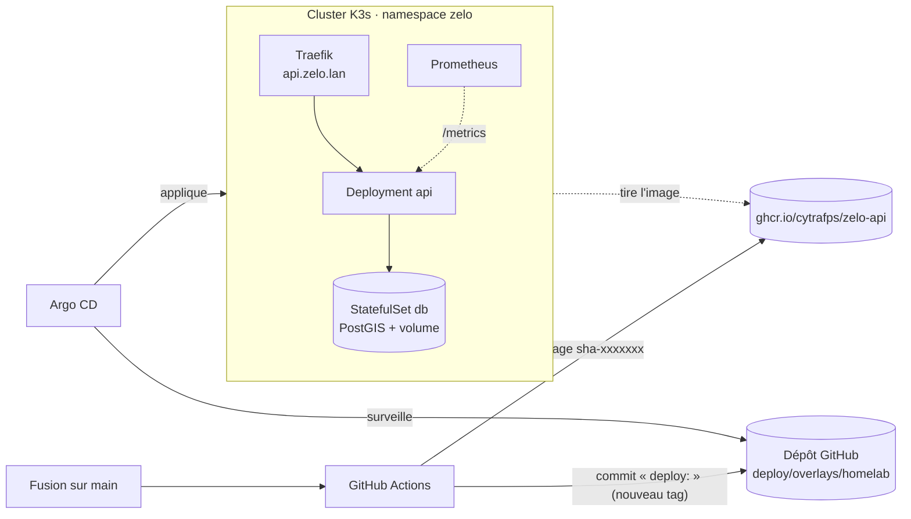

# Déploiement Kubernetes (K3s + Argo CD)

Zelo tourne sur un cluster K3s (le homelab) et se déploie en **GitOps**. Le dépôt décrit l'état voulu, Argo CD l'applique au cluster.



## Contenu

| Chemin | Rôle |
|---|---|
| `base/` | API (Deployment, Service), PostGIS (StatefulSet + volume 5 Go), Ingress, NetworkPolicy |
| `monitoring/` | ServiceMonitor, alertes (`alerts.yaml`, testées par `alerts_test.yml`), tableau de bord Grafana |
| `overlays/homelab/` | Environnement réel : domaine, zone d'import (Grand Reims), tag d'image écrit par la CI |
| `argocd/` | Applications Argo CD : `monitoring.yaml` (kube-prometheus-stack) et `zelo.yaml` |

## Choix

- **Deux répliques d'API, sans coordination en mémoire.**
  - Les signalements passent par PostgreSQL `LISTEN/NOTIFY`. Celui reçu par une réplique atteint les clients WebSocket de toutes les répliques, environ 50 ms mesurés.
  - Les collectes ne tournent que sur la réplique qui détient un verrou consultatif PostgreSQL (`pg_try_advisory_lock`). Si elle tombe, sa session se ferme et une autre reprend en 15 s au plus. La métrique `zelo_collector_leader` indique quelle réplique est meneuse.
  - Un PodDisruptionBudget, une mise à jour progressive sans indisponibilité et une répartition sur les nœuds évitent de couper le service lors d'une maintenance.
  - Limite connue : le quota de signalements par IP est compté par réplique, donc jusqu'à 2 fois plus permissif. Un compteur dans PostgreSQL ou Redis le rendra global si besoin.
- **Sondes séparées.** `livez` ne dépend pas de la base : une panne de PostgreSQL rend l'API « non prête », sans la faire redémarrer en boucle. `healthz` vérifie la base et sert de readiness.
- **Durcissement.**
  - Conteneur non root, système de fichiers en lecture seule, aucune capacité, seccomp `RuntimeDefault`, pas de jeton de service monté.
  - Les NetworkPolicy n'ouvrent la base qu'à l'API, et l'API qu'à Traefik et à Prometheus.
  - Seuls `/v1` et `/healthz` sont exposés par l'Ingress, donc `/metrics` reste interne.
- **Secret hors Git.** Le mot de passe de la base est créé à la main, une fois. Plus tard, Sealed Secrets ou SOPS permettront de le versionner chiffré.
- **Alertes.**
  - API injoignable.
  - Données non rafraîchies depuis 3 cycles de leur source : 30 min pour le carburant, 15 min pour l'état des bornes, 72 h pour les parkings.
  - Collecte en échec 3 fois en une heure.

## Installation sur le homelab

Prérequis : une VM Linux, avec 2 vCPU et 4 Go de RAM au minimum.

```sh
# 1. K3s (Traefik et stockage local inclus)
curl -sfL https://get.k3s.io | sh -
export KUBECONFIG=/etc/rancher/k3s/k3s.yaml

# 2. Argo CD
kubectl create namespace argocd
kubectl apply -n argocd --server-side -f https://raw.githubusercontent.com/argoproj/argo-cd/stable/manifests/install.yaml

# 3. Mot de passe de la base (hexadécimal : sûr dans une URL de connexion)
kubectl create namespace zelo
kubectl -n zelo create secret generic zelo-db --from-literal=password="$(openssl rand -hex 24)"

# 4. Applications (monitoring d'abord : ses CRD servent à Zelo)
kubectl apply -f deploy/argocd/monitoring.yaml
kubectl apply -f deploy/argocd/zelo.yaml
```

L'image est publiée sur GHCR au premier passage de la CI sur `main`. Rends le paquet public dans GitHub (Packages → zelo-api → Package settings → Change visibility). Sinon, ajoute un `imagePullSecret`.

Ensuite :

- **API** : fais pointer `api.zelo.lan` vers l'IP de la VM (DNS local ou fichier hosts), puis ouvre `http://api.zelo.lan/healthz`.
- **Argo CD** : `kubectl -n argocd port-forward svc/argocd-server 8443:443`. Le mot de passe `admin` se lit avec `kubectl -n argocd get secret argocd-initial-admin-secret -o jsonpath='{.data.password}' | base64 -d`.
- **Grafana** : `kubectl -n monitoring port-forward svc/monitoring-grafana 3000:80`, tableau de bord « Zelo · API ». Le mot de passe `admin` se lit avec `kubectl -n monitoring get secret monitoring-grafana -o jsonpath='{.data.admin-password}' | base64 -d`.

Pour exposer l'API sur Internet en HTTPS sans ouvrir de port, on prévoit un Cloudflare Tunnel, avec `TRUST_PROXY=true` pour lire la vraie IP des clients.

## Vérifier en local

```sh
kustomize build deploy/overlays/homelab | kubeconform -strict -summary -schema-location default \
  -schema-location 'https://raw.githubusercontent.com/datreeio/CRDs-catalog/main/{{.Group}}/{{.ResourceKind}}_{{.ResourceAPIVersion}}.json'
yq '{"groups": .spec.groups}' deploy/monitoring/alerts.yaml > rules.yml && promtool test rules deploy/monitoring/alerts_test.yml
```

La CI (job `deploy`) fait les mêmes vérifications à chaque pull request.
