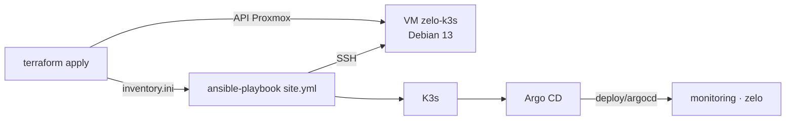

# Infrastructure

| Dossier | Rôle |
|---|---|
| `compose.yaml` | Environnement de développement (Docker Compose) : API, PostGIS, Valhalla, tunnel |
| `terraform/` | VM du cluster sur le Proxmox du homelab : Debian 13, cloud-init, IP fixe, clé SSH |
| `ansible/` | Installation de la VM : système, K3s, Argo CD, puis les applications de `deploy/argocd` |

Le cluster se reconstruit de zéro en deux commandes ; ensuite, Argo CD le tient à jour depuis `main` (voir [`deploy/`](../deploy/README.md) et l'[ADR 0010](../docs/adr/0010-infra-en-code.md)).



## Prérequis

- Sur le PC : Terraform 1.9 ou plus, Ansible 2.17 ou plus (`pipx install ansible-core`), une clé SSH.
- Sur Proxmox, une seule fois :
  - Activer le type de contenu **Import** sur le stockage `local` (Datacenter → Storage → local → Content). Proxmox 8.4 ou plus.
  - Créer un jeton d'API pour Terraform :
    ```sh
    pveum user add terraform@pve
    pveum role add Terraform -privs "Datastore.Allocate Datastore.AllocateSpace Datastore.AllocateTemplate Datastore.Audit Pool.Allocate Sys.Audit Sys.Console Sys.Modify SDN.Use VM.Allocate VM.Audit VM.Clone VM.Config.CDROM VM.Config.Cloudinit VM.Config.CPU VM.Config.Disk VM.Config.HWType VM.Config.Memory VM.Config.Network VM.Config.Options VM.Migrate VM.PowerMgmt"
    pveum aclmod / -user terraform@pve -role Terraform
    pveum user token add terraform@pve zelo --privsep 0
    ```
- Les paquets GitHub `zelo-api` et `zelo-valhalla` en visibilité publique, sinon le cluster ne peut pas tirer les images.

## Créer le cluster

```sh
cd infra/terraform
cp terraform.tfvars.example terraform.tfvars   # endpoint, jeton, IP fixe, clé SSH publique
terraform init
terraform apply                                 # VM créée et démarrée, inventaire Ansible écrit

cd ../ansible
ansible-galaxy collection install -r requirements.yml
ansible-playbook site.yml                       # ~10 min, dont le premier déploiement de Zelo
```

Ensuite, depuis le PC :

```sh
export KUBECONFIG=$PWD/kubeconfig               # écrit par Ansible
kubectl get pods -A
kubectl -n monitoring port-forward svc/monitoring-grafana 3000:80   # Grafana, tableau de bord « Zelo · API »
```

## Rejouer

- `ansible-playbook site.yml` est sans effet de bord sur une VM déjà installée. Il ne change jamais le mot de passe de la base.
- Monter de version K3s ou Argo CD, c'est changer `group_vars/k3s.yml` dans une PR, puis rejouer.
- `terraform apply` ne recrée pas la VM quand l'image Debian ou la clé change. Les mises à jour du système passent par Ansible (et `unattended-upgrades`).

## Ce qui reste hors du code

- **L'état Terraform** (`terraform.tfstate`) reste sur le PC, ignoré par Git : il contient le jeton. Pour une équipe, il faudrait un backend partagé (S3/MinIO, HTTP Gitlab…).
- **Le mot de passe de la base** est créé par Ansible dans le cluster, jamais écrit ailleurs.
- **Vérifié** : Terraform (`fmt`, `validate` sur le fournisseur réel) et Ansible (syntaxe, `ansible-lint` profil production) en CI. Le rôle `base` et la préparation de K3s ont aussi été rejoués sur une Debian 13 de test. L'installation de K3s et d'Argo CD n'a pas pu l'être dans ce bac à sable : elle sera validée au premier `ansible-playbook` sur le homelab.
